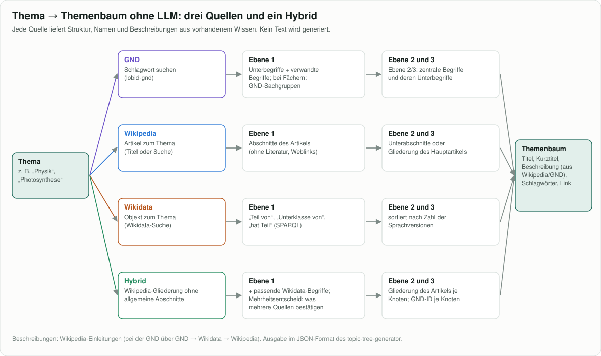
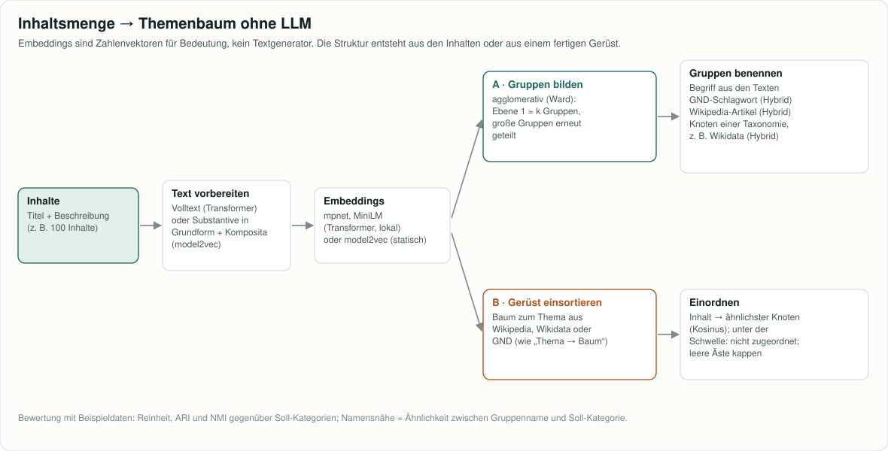

# Themenbaum ohne LLM

Demo-App, die **Themenbäume ohne generatives Sprachmodell** erzeugt: aus einem Thema (über GND, Wikipedia oder
Wikidata) oder aus einer unstrukturierten Inhaltsmenge (Embeddings + hierarchisches Clustering). Dazu eine
aufbereitete **Kostenanalyse** des bestehenden LLM-basierten Themenbaum-Generators mit Rechner.

Entstanden als Prüfung: Was kostet ein Themenbaum mit LLM, und wie weit kommt man ohne?



## Was die App bietet

| Bereich | Inhalt |
|---|---|
| **Thema → Baum** | Thema eingeben, Baum mit bis zu drei Ebenen aus GND, Wikipedia und Wikidata erzeugen – einzeln oder nebeneinander. Anderen Einstiegstreffer wählen, JSON herunterladen (Format des `topic-tree-generator`). |
| **Inhalte → Baum** | Inhaltsmenge (Beispieldaten oder eigene JSON/CSV) zu einem Baum bündeln: Embeddings (mpnet, MiniLM oder model2vec) + hierarchisches Clustering, Benennung über Begriffe aus den Texten, GND, Wikipedia oder eine Taxonomie, oder Einsortieren in ein Gerüst. Jeder Lauf als eigene Spalte zum Vergleichen, mit Kennzahlen gegenüber Soll-Kategorien. |
| **Kosten** | Kernergebnisse der Kostenanalyse mit Hauptgrafik, Details und einem Rechner für Inhaltsmenge, Anpassungsschleifen, Baumgröße, Kompendium und eigene Preise. |

Info-Knöpfe (ⓘ) und die Anzeigen „So entsteht dieser Baum“ bzw. „Ablauf dieses Laufs“ zeigen, welche Verfahren im
Hintergrund laufen. Die App ist **passwortgeschützt** (Login beim Aufruf).

## Dokumentation

- [docs/verfahren.md](docs/verfahren.md) – alle Verfahren kurz erklärt, mit Grafiken, Messergebnissen und Empfehlung
- [docs/kosten.md](docs/kosten.md) – Kostenanalyse mit allen Ergebnissen und Grafiken



## Ergebnisse in Kürze

- **Thema → Baum:** Wikipedia ist insgesamt am brauchbarsten, Wikidata stark bei ganzen Fächern, die GND nur dort.
  Keine Quelle ist didaktisch gegliedert.
- **Inhalte → Baum:** Embeddings + hierarchisches Clustering trifft bei 100 Beispielinhalten 64 % Reinheit
  (mpnet, ARI 0,39); model2vec mit Substantiven 59 % bei etwa 300-facher Geschwindigkeit. Hybride (Namen aus
  Wikipedia oder einer Wikidata-Taxonomie) liefern die besten Namen und echte Beschreibungen.
- **Kosten mit LLM:** Ein Themenbaum 12×5×5 kostet 0,07–0,16 $, ein Kompendium-Text je Sammlung 2,83–8,18 $ für
  372 Knoten. Metadaten für Inhalte skalieren linear (etwa 0,1 Cent je Inhalt).

## Schnellstart lokal

Voraussetzung: [uv](https://docs.astral.sh/uv/) und Python ≥ 3.12.

```bash
git clone https://github.com/janschachtschabel/topic-tree-llm-free.git
cd topic-tree-llm-free
cp .env.example .env      # APP_PASSWORD, WIKIMEDIA_CONTACT und COOKIE_SECURE=false eintragen
uv run uvicorn themenbaum.main:app --port 8000
```

Dann http://localhost:8000 öffnen und mit dem Passwort anmelden. Lokal ohne HTTPS muss `COOKIE_SECURE=false` gesetzt
sein, sonst hält das Login nicht.

Alternativ mit Docker (eigener Build):

```bash
docker compose -f docker-compose.build.yml up --build
```

## Online stellen bei Hostinger (Docker Manager)

Die `docker-compose.yml` im Hauptordner ist für den Hostinger Docker Manager gebaut: Der erste Start gelingt ohne
Variablen, HTTPS übernimmt Hostingers Traefik über Labels, das Image kommt fertig aus der GitHub Container Registry.

1. **Image bereitstellen:** Jeder Push auf `main` baut per GitHub Actions `ghcr.io/janschachtschabel/topic-tree-llm-free:main`.
   Einmalig auf GitHub unter *Packages → topic-tree-llm-free → Package settings* die Sichtbarkeit auf **Public**
   stellen, sonst kann der VPS das Image nicht laden.
2. **Projekt anlegen:** Docker Manager → Compose → *Compose from URL* →
   `https://github.com/janschachtschabel/topic-tree-llm-free`, Anwendungsname übernehmen, bereitstellen.
3. **Konfigurieren:** Projekt *Bearbeiten* → `.env` ausfüllen (mindestens `DOMAIN`, `APP_PASSWORD`,
   `WIKIMEDIA_CONTACT`) → erneut bereitstellen.
4. **DNS:** A-Eintrag der Domain auf die VPS-IP; das Zertifikat holt Traefik automatisch. Ohne eigene Domain geht
   der VPS-Hostname `srvNNNNNN.hstgr.cloud`.

Bei „Bereitstellung fehlgeschlagen“ steht die Ursache in `/docker/<projekt>/.build.log` (Webkonsole im Docker Manager).

**Ressourcen:** Die Embedding-Modelle werden beim ersten Gebrauch heruntergeladen und im Volume `themenbaum-data`
gespeichert (mpnet ≈1 GB, MiniLM ≈0,22 GB, model2vec ≈0,32 GB). Empfohlen sind 2–3 GB freier Arbeitsspeicher. Der
erste Lauf eines Verfahrens dauert deshalb deutlich länger.

## Konfiguration

| Variable | Pflicht | Bedeutung |
|---|---|---|
| `APP_PASSWORD` | ja | Zugangspasswort. Leer = App bleibt gesperrt. |
| `WIKIMEDIA_CONTACT` | für Wikipedia/Wikidata | E-Mail oder URL im User-Agent; Wikimedia lehnt Anfragen ohne Kontakt ab. Ohne Wert funktioniert nur die GND. |
| `DOMAIN` | für Hostinger | reiner Hostname ohne `https://` |
| `SESSION_SECRET` | nein | Schlüssel für Sitzungs-Cookies; leer = wird zufällig erzeugt und im Volume gespeichert |
| `SESSION_HOURS` | nein | Dauer einer Anmeldung (Standard 168 = 7 Tage) |
| `COOKIE_SECURE` | nein | Cookies nur über HTTPS (Standard `true`; lokal ohne HTTPS `false`) |
| `IMAGE_TAG` | nein | Image-Tag (Standard `main`) |
| `TRAEFIK_NETWORK`, `TRAEFIK_ENTRYPOINT`, `TRAEFIK_CERTRESOLVER` | nein | nur ändern, wenn Traefik anders konfiguriert ist |
| `DATA_DIR` | nein | Datenordner für Cache, Modelle, Session-Schlüssel (im Container `/data`) |

**Schutz:** Login-Seite mit signiertem, HttpOnly-Cookie; nach 8 Fehlversuchen in 10 Minuten wird eine IP gesperrt.
Ändert man `APP_PASSWORD`, werden bestehende Anmeldungen ungültig.

## Projektstruktur

```
themenbaum/            FastAPI-App
  main.py              Routen, Login, Seiten
  auth.py              Passwortschutz
  gnd.py, wikipedia.py, wikidata.py   Thema → Baum je Quelle
  contents.py          Inhalte → Baum (Embeddings, Clustering, Benennung, Gerüst)
  common.py            HTTP mit Cache, Ausgabeformat
  static/              Oberfläche (Thema, Inhalte, Kosten, Grafiken)
data/                  Beispielinhalte, Kostendaten
docs/                  Verfahren, Kosten, Grafiken
scripts/               Kostenmodell und Grafiken reproduzieren
Dockerfile, docker-compose.yml (Hostinger), docker-compose.build.yml (lokal)
```

## Hinweise

- Antworten der öffentlichen APIs werden eine Woche im Datenordner zwischengespeichert. Eingegebene Inhalte werden
  nicht gespeichert.
- GND über [lobid-gnd](https://lobid.org/gnd) (hbz), Wikipedia und Wikidata über die Wikimedia-APIs. Bitte deren
  Nutzungsbedingungen beachten.

## Lizenz

[Apache License 2.0](LICENSE)
