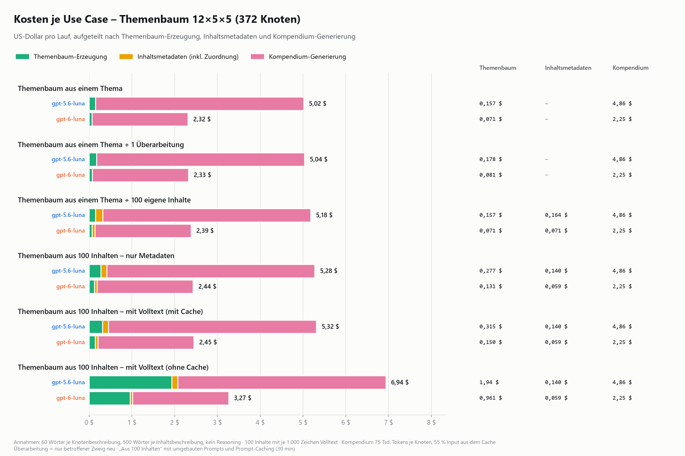
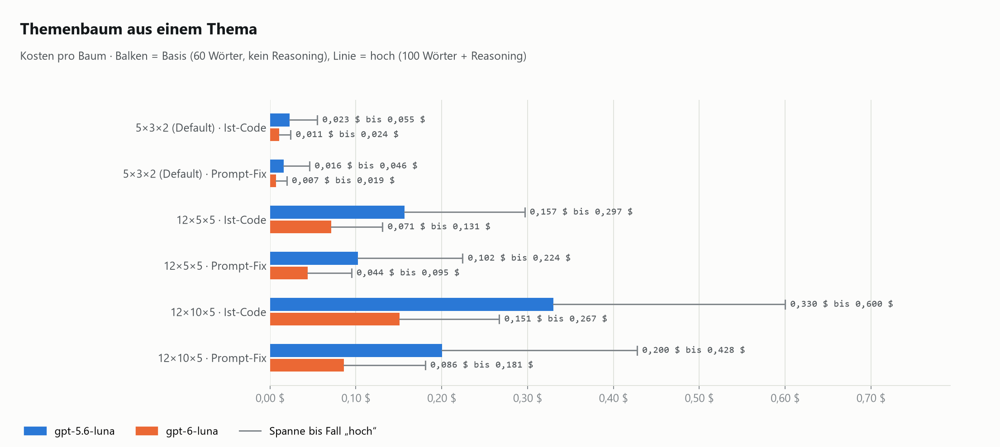
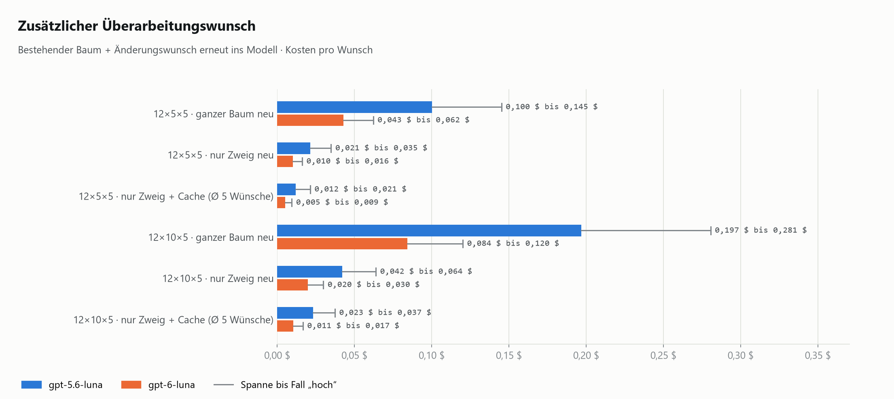
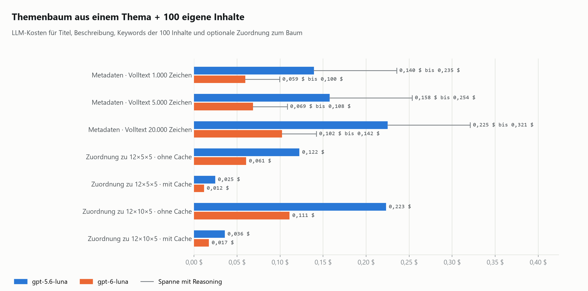
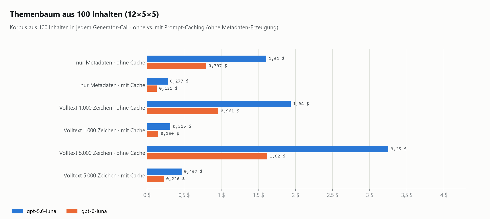
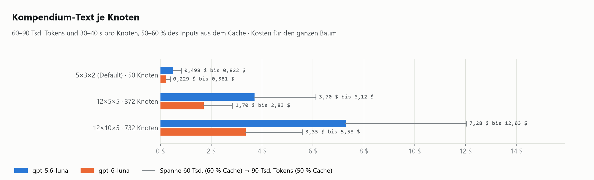

# Kosten eines LLM-basierten Themenbaums

Diese Analyse schätzt die LLM-Kosten des bestehenden Themenbaum-Generators
(`topic-tree-generator`, FastAPI, API 1.2.6) für drei Use Cases. Sie war der
Anlass für diese Demo: Lässt sich die Themenbaum-Erzeugung auch **ohne generatives LLM** umsetzen?
Die Ergebnisse sind in der App unter **Kosten** kompakt aufbereitet, mit einem interaktiven Diagramm und einem
Rechner für eigene Annahmen.

Alle Beträge in US-Dollar. Gerechnet für **gpt-6-luna** und **gpt-5.6-luna**.

## Kurzfassung

- **Der Themenbaum selbst ist günstig:** 0,07–0,16 $ für 12×5×5 (372 Knoten), 0,15–0,33 $ für 12×10×5 (732 Knoten).
- **Ein Kompendium-Text je Sammlung dominiert** mit über 90 % der Kosten: 1,70–6,12 $ für 372 Knoten
  (60–90 Tsd. Tokens je Knoten, 50–60 % des Inputs aus dem Cache). Bei mehreren hundert Knoten kommt trotz kleiner
  Einzelbeträge einiges zusammen.
- **Inhalte skalieren linear mit der Menge:** beschreibende Metadaten (Titel, Beschreibung mit 500 Wörtern, Keywords)
  aus je rund 1.000 Zeichen Webseiten-Volltext kosten etwa 0,06–0,14 Cent je Inhalt. Fach und Bildungsstufe laufen
  ohne LLM. Caching gibt es hier kaum, weil jeder Inhalt einen eigenen Volltext hat.
- **Überarbeitungswünsche sind billig**, wenn nur der betroffene Zweig neu erzeugt wird (1–4 Cent).
- **Caching beim Themenbaum lohnt nur bei großem, gleichbleibendem Kontext**, etwa wenn die Metadaten aller Inhalte in
  jede Knotenabfrage gehen: Der Baum kostet dann 0,15–0,32 $ mit Cache statt 0,96–1,94 $ ohne.

| Use Case (12×5×5, inkl. Kompendium) | gpt-6-luna | gpt-5.6-luna |
|---|---:|---:|
| Themenbaum aus einem Thema | 2,32 $ | 5,02 $ |
| … + 1 Überarbeitung | 2,33 $ | 5,04 $ |
| … + 100 eigene Inhalte | 2,39 $ | 5,18 $ |
| Themenbaum aus 100 Inhalten, nur Metadaten (Cache) | 2,44 $ | 5,28 $ |
| Themenbaum aus 100 Inhalten, Metadaten + Volltext (Cache) | 2,45 $ | 5,32 $ |
| Themenbaum aus 100 Inhalten, Metadaten + Volltext (ohne Cache) | 3,27 $ | 6,94 $ |

Kompendium je Zeile: 2,25 $ bzw. 4,86 $. Dieselbe Übersicht für 12×10×5:
[`kosten/00b_uebersicht_usecases_12x10x5.png`](kosten/00b_uebersicht_usecases_12x10x5.png).

## Preise und Annahmen

| Modell (je 1 Mio. Tokens) | Input | Output | Cache lesen | Cache schreiben (30 min) |
|---|---:|---:|---:|---:|
| gpt-6-luna | 0,10 $ | 0,50 $ | 0,01 $ | 0,125 $ |
| gpt-5.6-luna | 0,20 $ | 1,20 $ | 0,02 $ | 0,25 $ |

- **Tokens:** Die Prompts stammen 1:1 aus `src/prompts.py` des Generators, gezählt mit dem o200k-Tokenizer
  (Abweichung zum echten Tokenizer etwa ±10–15 %). Deutscher Text: 0,225 Tokens je Zeichen, 1,925 Tokens je Wort.
- **Themenbaum:** 1 Aufruf für die Hauptthemen, 1 je Hauptthema, 1 je Unterthema (12×5×5 = 73 Aufrufe,
  12×10×5 = 133). System-Prompt 578 Tokens; ein Knoten im Output 190 Tokens bei 60 Wörtern Beschreibung. Die
  Modelle schöpfen die Obergrenzen voll aus. **Hoch:** 100 Wörter und 1.000 Reasoning-Tokens je Aufruf.
- **Inhaltsmetadaten:** je Inhalt 1 Aufruf mit dem Volltext der Webseite (Standard 1.000 Zeichen ≈ 225 Tokens) und
  einer Anweisung von 582 Tokens. Output 65 Tokens (Titel, Keywords) + Beschreibung mit 500 Wörtern ≈ 1.030 Tokens.
  Kein Caching, weil jeder Aufruf einen anderen Volltext hat.
- **Kompendium:** 60–90 Tsd. Tokens und 30–40 Sekunden je Knoten, davon 4–6 Tsd. Output; 50–60 % des Inputs kommen
  aus dem Cache (zum Cache-Lesepreis). Mittelwert für Übersicht und Rechner: 75 Tsd. Tokens, 5 Tsd. Output, 55 %.
- **Caching beim Themenbaum:** nur sinnvoll, wenn ein großer Kontext für jede Knotenabfrage gleich bleibt. Beim
  normalen Baum ist der gemeinsame Teil (578 Tokens) zu klein. Beim „Themenbaum aus Inhalten“ wird der Korpus einmal
  geschrieben (Cache-Schreibpreis) und danach zu 10 % des Input-Preises gelesen.
- Nicht enthalten: Crawler, Hosting, Wiederholungen nach API-Fehlern.

Frühere Fassungen dieser Analyse rechneten mit 250 Output-Tokens je Inhalt (≈95 Wörter Beschreibung), 5 Tsd. Tokens
Volltext und einem Kompendium von 60–80 Tsd. Tokens ohne Caching.

## Use Case 1: Themenbaum aus einem Thema

| Baum | Aufrufe | Knoten | gpt-6-luna | gpt-5.6-luna | hoch (6 / 5.6) |
|---|---:|---:|---:|---:|---:|
| 5×3×2 (Default), aktueller Code | 21 | 50 | 0,011 $ | 0,023 $ | 0,024 / 0,055 $ |
| 12×5×5, aktueller Code | 73 | 372 | 0,071 $ | 0,157 $ | 0,131 / 0,297 $ |
| 12×5×5, mit Prompt-Fix | 73 | 372 | 0,044 $ | 0,103 $ | 0,095 / 0,224 $ |
| 12×10×5, aktueller Code | 133 | 732 | 0,151 $ | 0,330 $ | 0,267 / 0,600 $ |
| 12×10×5, mit Prompt-Fix | 133 | 732 | 0,086 $ | 0,200 $ | 0,181 / 0,428 $ |

„Prompt-Fix“ = in den Kontextlisten nur Titel statt ganzer Objekte (siehe Befunde unten).

### Zusätzlicher Überarbeitungswunsch

Bestehender Baum + Änderungswunsch gehen erneut ins Modell.

| Variante (12×10×5) | gpt-6-luna | gpt-5.6-luna |
|---|---:|---:|
| A: ganzer Baum neu ausgeben | 0,084 $ | 0,197 $ |
| B: nur betroffener Zweig (1 Hauptthema) | 0,020 $ | 0,042 $ |
| B + Cache (Ø über 5 Wünsche in 30 min) | 0,011 $ | 0,023 $ |

Variante A passt bei 12×10×5 nicht in eine Antwort (140–200 Tsd. Output-Tokens bei typischen 128 Tsd. Grenze) und
müsste gestückelt werden. Variante B ist die sinnvolle Umsetzung.

## Use Case 2: Nutzer bringt 100 Inhalte mit

Der Crawler liefert die Volltexte der Webseiten, Fach und Bildungsstufe kommen ohne LLM aus. Per LLM entstehen nur
Titel, Beschreibung und Keywords (1 Aufruf je Inhalt). Optional werden die Inhalte einem bestehenden Baum zugeordnet;
dort lohnt sich Prompt-Caching, weil die Titelliste des Baums in allen Aufrufen gleich bleibt.

| Schritt (100 Inhalte, Beschreibung 500 Wörter) | gpt-6-luna | gpt-5.6-luna |
|---|---:|---:|
| Metadaten aus 1.000 Zeichen Volltext (Standard) | 0,060 $ | 0,140 $ |
| Metadaten aus 5.000 Zeichen Volltext | 0,069 $ | 0,158 $ |
| Metadaten aus 20.000 Zeichen Volltext | 0,102 $ | 0,225 $ |
| Zuordnung zu 12×5×5, ohne / mit Cache | 0,061 / 0,012 $ | 0,122 / 0,025 $ |

Der Output (Beschreibung) bestimmt die Kosten stärker als die Länge des Volltexts.

## Use Case 3: Struktur aus 100 Inhalten ableiten

Es gibt keine Strukturvorgabe; die erzeugten Metadaten aller 100 Inhalte (≈1.030 Tokens je Inhalt), wahlweise mit
Volltext, gehen in **jeden** Aufruf des Generators. Caching wirkt stark, weil dieser Kontext für jede Knotenabfrage
gleich bleibt; dafür müssen die Prompts umgebaut werden (Korpus vorne, variable Teile hinten).

| Korpus im Kontext (12×5×5) | Tokens je Aufruf | ohne Cache (6 / 5.6) | mit Cache (6 / 5.6) |
|---|---:|---:|---:|
| nur Metadaten | 103 Tsd. | 0,80 / 1,61 $ | 0,13 / 0,28 $ |
| Metadaten + Volltext 1.000 Zeichen | 126 Tsd. | 0,96 / 1,94 $ | 0,15 / 0,32 $ |
| Metadaten + Volltext 5.000 Zeichen | 216 Tsd. | 1,62 / 3,25 $ | 0,23 / 0,47 $ |

12×10×5: [`kosten/04b_baum_aus_100_inhalten_12x10x5.png`](kosten/04b_baum_aus_100_inhalten_12x10x5.png)
(bis 5,94 $ ohne Cache). Bei längeren Volltexten oder mehr Inhalten wird das Kontextfenster zur Grenze; der Rechner
warnt ab 400 Tsd. Tokens je Aufruf.

## Kompendium-Text je Sammlung

60–90 Tsd. Tokens und 30–40 Sekunden je Knoten, davon 4–6 Tsd. Output, 50–60 % des Inputs aus dem Cache.

| Baum | Knoten | gpt-6-luna | gpt-5.6-luna | Laufzeit seriell | bei 10 parallel |
|---|---:|---:|---:|---:|---:|
| 5×3×2 | 50 | 0,23–0,38 $ | 0,50–0,82 $ | 0,5 h | 3 min |
| 12×5×5 | 372 | 1,70–2,83 $ | 3,70–6,12 $ | 3,6 h | 22 min |
| 12×10×5 | 732 | 3,35–5,58 $ | 7,28–12,03 $ | 7,1 h | 43 min |

Untere Grenze: 60 Tsd. Tokens mit 60 % Cache-Treffern; obere Grenze: 90 Tsd. Tokens mit 50 %. Nur Ebene 1 und 2 mit
Kompendium (132 statt 732 Knoten) senkt Kosten und Zeit um 82 %.

## Befunde im bestehenden Generator, die Kosten treiben

1. **Ganze Objekte statt Titel im Prompt** (`main.py:230`, `main.py:270`): `f"- {main_topic_title}"` über
   `main_topics` schreibt das ganze `Collection`-Objekt samt Beschreibung und URIs in den Prompt (≈245 Tokens je
   Eintrag). Bei 12×10×5 sind das 80 % des Inputs; mit `.title` wird ein Baum 35–43 % günstiger.
2. **Die Wortgrenze kommt nie an** (`src/prompts.py:47`): `{max_description_length}` in `BASE_INSTRUCTIONS` wird nie
   formatiert; die Templates haben den Platzhalter nicht. Beschreibungen werden eher länger.
3. **Kein `reasoning_effort` gesetzt:** Bei Reasoning-Modellen fallen standardmäßig Reasoning-Tokens an (50–100 %
   mehr Output).
4. **Caching greift beim Baum nicht:** Der gemeinsame Präfix (578 Tokens) liegt unter der üblichen Mindestlänge.
5. **Kaputtes JSON wird bezahlt und verworfen** (`src/structured_text_helper.py:85`): kein neuer Versuch, der Zweig fehlt.

## Fazit

- Die Baumerzeugung ist nicht das Kostenproblem, auch nicht ein einzelner Kompendium-Text. Die Kosten wachsen mit
  der **Zahl der Knoten** (Kompendium) und der **Zahl der Inhalte** (beschreibende Metadaten).
- Ein Themenbaum ohne LLM spart deshalb wenig Geld. Gründe dafür sind eher Reproduzierbarkeit, Nachvollziehbarkeit,
  Lehrplannähe und Unabhängigkeit von LLM-Anbietern. Diese Demo zeigt, wie weit man damit kommt
  (siehe [verfahren.md](verfahren.md)).
- Auch AcademicCloud über die B-API ist inzwischen kostenpflichtig wie jede andere API.

## Nachrechnen

- **Rechner in der App** (Bereich „Kosten“): Inhaltsmenge, Volltextlänge, Beschreibungslänge, Anpassungsschleifen,
  Baumgröße, Kompendium (Tokens, Cache-Quote) und Preise frei einstellbar; das Diagramm aller Use Cases rechnet live
  mit. Es nutzt dieselben Formeln wie `scripts/kostenmodell.py` und ergibt mit den Standardwerten genau die Werte der
  Übersichtsgrafik.
- **Skripte:** [`scripts/kostenmodell.py`](../scripts/kostenmodell.py) zählt die Tokens aus einem Checkout des
  Generators und schreibt [`data/kosten.json`](../data/kosten.json);
  [`scripts/grafiken_kosten.py`](../scripts/grafiken_kosten.py) erzeugt daraus die Grafiken in `docs/kosten/`.
