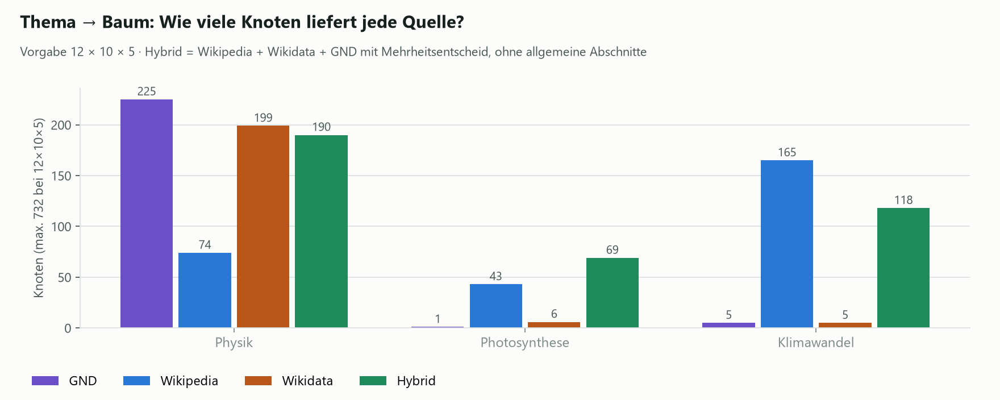
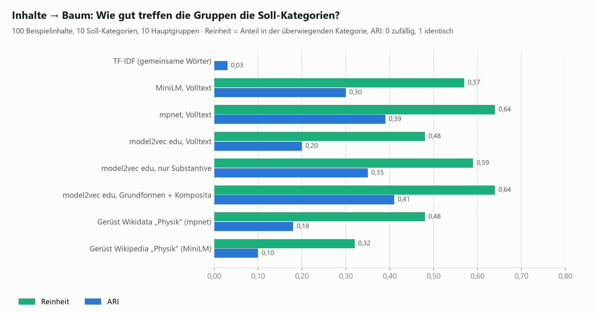
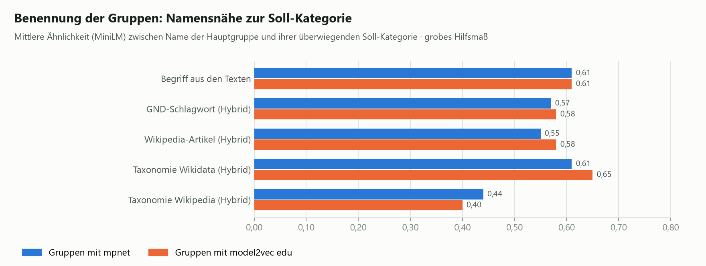

# Verfahren: Themenbäume ohne generatives LLM

Diese Seite erklärt die Verfahren der Demo so, dass man sie nachnutzen, nachbauen oder bewerten kann. Kein Verfahren
erzeugt Text mit einem Sprachmodell: Struktur, Namen und Beschreibungen kommen aus vorhandenem Wissen (GND,
Wikipedia, Wikidata) oder aus den Inhalten selbst. Embedding-Modelle werden nur zum Vergleichen von Bedeutung
genutzt.

Die Demo hat dafür zwei Bereiche: **Thema → Baum** und **Inhalte → Baum**. Jede Ergebnisspalte zeigt in der App unter
„So entsteht dieser Baum“ bzw. „Ablauf dieses Laufs“, welche Schritte tatsächlich gelaufen sind.

## 1. Thema → Baum

Ohne LLM kann man keine Struktur erfinden; man leitet sie aus einer vorhandenen Quelle ab. Die Demo kennt drei:

| Quelle | Wie der Baum entsteht | Stärken | Schwächen |
|---|---|---|---|
| **GND** (über [lobid-gnd](https://lobid.org/gnd)) | Unterbegriffe des Schlagworts (Ober-/Unterbegriffs-Relationen), ergänzt um verwandte Begriffe. Bei Fächern mit wenig Hierarchie (z. B. „Physik“) bilden die **GND-Sachgruppen** des Fachs Ebene 1; Ebene 2 sind die Begriffe, auf die in der Sachgruppe die meisten anderen als Oberbegriff verweisen. | Normdaten mit IDs, gut für Schlagwörter; Ebene 3 oft fachlich gut | Hierarchie sehr dünn: „Photosynthese“ liefert 1 Knoten; Ebene 2 bei Fächern verrauscht |
| **Wikipedia** | Gliederung des Artikels zum Thema; hat ein Abschnitt keine Unterabschnitte, wird die Gliederung seines `{{Hauptartikel}}` übernommen. Beschreibungen aus Artikeleinleitung oder Abschnittstext. | Bei konkreten Themen meist sinnvolle Gliederung, gute Beschreibungen | Abschnitte wie „Geschichte“ oder „Rezeption“; nicht didaktisch gegliedert |
| **Wikidata** | Objekte, die „Teil von“ (P361) oder „Unterklasse von“ (P279) des Elternobjekts sind oder die es als „hat Teil“ (P527) nennt; sortiert nach Zahl der Sprachversionen. | Bei Fächern inhaltlich stimmig, fast alle Knoten beschrieben | Bei freien Themen dünn oder schief („Klimawandel in Südkorea“) |

**Erfahrung aus den Tests:** Wikipedia war insgesamt am brauchbarsten und für weitere Tests „ausreichend gut“.
Wikidata ist bei ganzen Fächern stark, die GND nur dort. Keine Quelle ist didaktisch gegliedert oder auf eine
Bildungsstufe zugeschnitten; das bleibt die Lücke gegenüber dem LLM.

**Nicht umgesetzt, aber naheliegend:** Lehrpläne als Quelle (PDF → Markdown, z. B. mit docling, und Überschriften als
Gliederung). Das liefert didaktisch passende Strukturen für Schulfächer, braucht aber je Bundesland eigene Parser,
weil Überschriften in PDFs oft nicht ausgezeichnet sind.

## 2. Inhalte → Baum

### Text vorbereiten und Embeddings

Jeder Inhalt wird aus Titel (doppelt gewichtet) und Beschreibung zu einem Vektor. Zur Auswahl stehen:

| Modell | Art | Größe | Zeit für 100 Texte | Hinweis |
|---|---|---|---|---|
| `paraphrase-multilingual-mpnet-base-v2` | Transformer, lokal (fastembed/ONNX) | ≈1 GB | ≈15 s (CPU) | beste Gruppen mit Volltext |
| `paraphrase-multilingual-MiniLM-L12-v2` | Transformer, lokal | ≈0,22 GB | ≈3 s | schneller, etwas schwächer |
| [`JanSchachtschabel/m2v-gte-256-edu`](https://huggingface.co/JanSchachtschabel/m2v-gte-256-edu) | statische Wortvektoren (model2vec) | ≈0,32 GB | ≈0,05 s | ohne Transformer; braucht **Substantive in Grundform** als Eingabe |

Statische Modelle mitteln Wortvektoren; Füllwörter verwässern diesen Mittelwert. Deshalb wählt die Einstellung
„Text vorbereiten → automatisch“ für model2vec beim Gruppenbilden die Substantive in Grundform mit zerlegten
Komposita (beim Einsortieren in ein Gerüst nur die Substantive), für Transformer den Volltext. TF-IDF ist als
Vergleich ebenfalls wählbar, taugt bei Texten dieser Länge aber nicht.

### A · Gruppen bilden (Embeddings + hierarchisches Clustering)

- **Agglomeratives Clustering nach Ward:** Ähnlichste Inhalte werden schrittweise zusammengelegt. Ebene 1 schneidet
  diese Hierarchie bei k Gruppen (fest oder per Silhouette-Wert zwischen 4 und 14 gewählt). Gruppen ab einer
  Mindestgröße (Standard 8) werden erneut hierarchisch in 2–4 Untergruppen geteilt.
- Ward war im Vergleich mit Average-Linkage, k-Means und Spectral Clustering am stabilsten.
- **Gruppenbeschreibung:** die drei Inhalte, die dem Gruppenzentrum am nächsten liegen (bei Wikipedia-/Taxonomie-
  Namen zusätzlich der Text des Artikels bzw. Knotens).

**Gruppen benennen** – die Struktur bleibt gleich, nur Name und Beschreibung ändern sich:

| Benennung | Wie |
|---|---|
| Schlagwortliste | die 3 Begriffe, die die Gruppe von ihren Geschwistern unterscheiden (c-TF-IDF wie bei BERTopic) |
| Begriff aus den Texten | Substantiv, das dem Gruppenzentrum nahe ist **und** in vielen Inhalten der Gruppe vorkommt |
| GND-Schlagwort (Hybrid) | Gruppenbegriffe in der GND nachschlagen; nur Schlagwörter mit genau diesem Namen zählen |
| Wikipedia-Artikel (Hybrid) | zu den häufigsten Gruppenbegriffen Artikel suchen; der Artikel, dessen Titel und Einleitung dem Gruppenzentrum am nächsten sind, liefert Name, Link und Beschreibung |
| In Taxonomie einordnen (Hybrid) | ein Baum zum Thema (Wikidata empfohlen) dient als Vokabular; jede Hauptgruppe bekommt den ähnlichsten Knoten der oberen zwei Ebenen, Untergruppen bevorzugt einen Knoten darunter |

### B · In Gerüst einsortieren

Ein Baum zum Thema (wie unter „Thema → Baum“) ist das Gerüst. Jeder Inhalt kommt an den Knoten mit der höchsten
Kosinus-Ähnlichkeit; unter einer Mindest-Ähnlichkeit bleibt er „nicht zugeordnet“. Leere Äste werden gekappt.

### Ergebnisse mit den Beispieldaten

[`data/beispiel_inhalte.json`](../data/beispiel_inhalte.json): 100 Physik-Inhalte (Titel + 570–790 Zeichen
Beschreibung) in 10 Soll-Kategorien mit bewussten Überschneidungen, von einem LLM als Testdaten erzeugt. Die
Soll-Kategorie dient nur der Bewertung.

- **Reinheit:** Anteil der Inhalte, die in ihrer Gruppe zur überwiegenden Soll-Kategorie gehören.
- **ARI / NMI:** Übereinstimmung mit der Soll-Einteilung (0 = zufällig, 1 = identisch).
- **Namensnähe:** mittlere Ähnlichkeit zwischen Gruppenname und Soll-Kategorie (grobes Hilfsmaß).

**Was das bedeutet:**

- **Embeddings + hierarchisches Clustering ist das stärkste Verfahren.** Klar abgegrenzte Themen (Optik, Akustik,
  Astronomie, Strahlung) werden fast sauber getroffen; querliegende Kategorien („Messen und Arbeitsweisen“) und
  verwandte Paare (Energie/Elektrizität, Wärmelehre/Klima) mischen sich.
- **model2vec mit Substantiven in Grundform und zerlegten Komposita** erreicht dieselbe Reinheit wie mpnet (64 %,
  ARI 0,41), ist aber rund 300-mal schneller und braucht kein PyTorch (siehe Abschnitt 3).
- **Hybride verbessern Namen und Beschreibungen, nicht die Gruppen.** Die Wikidata-Taxonomie liefert die fachlich
  saubersten Namen (Mechanik, Kernphysik, Thermodynamik, Optik); Wikipedia-Artikel bringen zusätzlich echte
  Beschreibungstexte. Die Wikipedia-Gliederung taugt dagegen nicht als Taxonomie (Abschnitte wie „Methodik“).
- **Ein fremdes Gerüst passt schlechter als selbst gebildete Gruppen.**
- **Grenze der Menge:** Mit 100 Inhalten und 5–10 Inhalten je Blatt sind sinnvoll 10–20 Knoten auf zwei Ebenen
  möglich, keine 372.

### Empfehlung

- **Thema als Eingabe:** Wikipedia als Grundlage; für Fächer Wikidata. Für Schulfächer mittelfristig Lehrpläne.
- **Inhaltsmenge:** Embeddings + hierarchisches Clustering, benannt über Wikipedia-Artikel oder eine Wikidata-
  Taxonomie. Für große Mengen oder schwache Hardware model2vec mit Grundformen + Komposita.
- **Vor einer Entscheidung** mit echten Inhalten testen; die Beispieldaten sind sauberer als reale Plattformtexte.

## 3. Getestete Verbesserungen für model2vec

Ausgangspunkt: model2vec `m2v-gte-256-edu`, nur Substantive, Ward-Clustering, 100 Beispielinhalte. Testskript:
[`scripts/test_verbesserungen.py`](../scripts/test_verbesserungen.py).

| Maßnahme | ARI (10 Gruppen) | Reinheit | Ergebnis |
|---|---:|---:|---|
| Ausgangspunkt: nur Substantive | 0,35 | 59 % | – |
| Füllwörter automatisch erkennen (Substantive in mehr als 12–30 % der Inhalte entfernen) | 0,35–0,36 | 58–59 % | kein Gewinn; strengere Schwellen entfernen Fachbegriffe wie „Energie“ |
| Grundformen (simplemma) | 0,36 | 62 % | leicht besser |
| **Grundformen + Komposita** (Grundwort am Wortende zusätzlich, wenn es im Bestand vorkommt) | **0,41** | **64 %** | **übernommen** für das Gruppenbilden mit model2vec |
| Gelenktes Clustering: 12 Wikidata-Knoten „Physik“ als Startpunkte | 0,13–0,18 | 36–47 % | schlechter; das Gerüst passt nicht zu den Inhalten (Vakuum, Biophysik statt Energie, Wetter, Messen) |
| Gelenktes Clustering: 10 Startpunkte aus 103 Gerüstknoten nach Datenlage gewählt | 0,18–0,27 | 45–55 % | schlechter als freies Clustering |
| Einsortieren ins Gerüst mit Grundformen + Komposita | 0,13 | 43 % | kein Gewinn (mit Substantiven 0,17); dort bleibt „nur Substantive“ |

Benennung (Namensnähe zur Soll-Kategorie): Begriff aus den Texten 0,61 · Oberbegriff frei aus Wikidata 0,46
(landet bei zu allgemeinen Klassen wie „physikalische Eigenschaft“, weil die Suche Begriffe oft auf das falsche
Objekt abbildet) · Oberbegriff nur innerhalb des Wikidata-Gerüsts 0,57 · vorhandene Taxonomie-Benennung 0,61–0,65.
Oberbegriffe aus Wikidata wurden deshalb nicht übernommen.

Der Gewinn durch Grundformen + Komposita ist nicht bei jeder Gruppenzahl gleich: bei 8–12 Gruppen ARI +0,04 bis
+0,08, bei 6 Gruppen niedriger, bei 14 gleich. Bei 100 Inhalten liegt das nahe am Messrauschen; mit echten Daten
nachmessen.

## 4. Bewusst nicht umgesetzt

| Verfahren | Grund |
|---|---|
| Klassische Topic-Modelle (LDA, hLDA, NMF) | brauchen Tausende Dokumente; bei 100 Inhalten zu wenig Daten |
| Keyword-Graph mit Community-Erkennung | vorab nur mittel eingeschätzt; hängt stark an der Qualität der Keywords |
| Lehrpläne als Quelle | lohnend, aber Parser je Bundesland nötig (siehe oben) |

## 5. Nachnutzen

- **API** (nach Anmeldung, Cookie-basiert): `GET /api/tree?source=gnd|wikipedia|wikidata&theme=…&n1=12&n2=10&n3=5`
  und `POST /api/contents/tree` mit `{"contents": [{"title": "…", "description": "…"}], "config": {…}}`.
  Die Konfiguration entspricht den Feldern der Oberfläche (siehe `themenbaum/contents.py`, Funktion `build`).
- **Ausgabeformat:** dasselbe JSON wie der `topic-tree-generator` (`metadata` + `collection` mit `title`,
  `shorttitle`, `properties`, `subcollections`), ergänzt um `_source` (Herkunft und Link) bzw. `_contents`
  (zugeordnete Inhalte). Download in der App per „JSON herunterladen“.
- **Code:** Quellen in `themenbaum/gnd.py`, `wikipedia.py`, `wikidata.py`; Inhaltsverfahren in `themenbaum/contents.py`.
